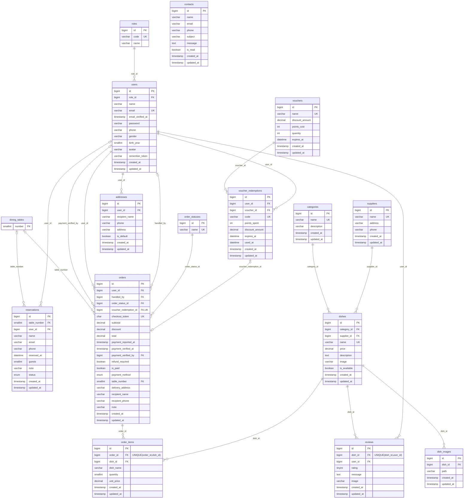

# Từ điển dữ liệu MySQL

Nguồn chuẩn: `database/migrations/0001_01_01_000000_create_users_table.php`, hai migration cache/jobs của Laravel và `2026_10_17_143034_create_restaurant_tables.php` và migration nâng cấp `2026_10_18_125728_update_restaurant_roles_payment_and_tables.php`. MySQL InnoDB, charset utf8mb4, collation utf8mb4_unicode_ci.

## Quy ước

- Ngoại lệ dining_tables.number là SMALLINT UNSIGNED PK, không tự tăng, không timestamps. Mọi `id` nghiệp vụ khác: BIGINT UNSIGNED, PK, AUTO_INCREMENT.
- Ngoại trừ roles/order_statuses, mỗi bảng nghiệp vụ có `created_at`, `updated_at`: TIMESTAMP NULL, được Eloquent điền khi ghi.
- Các cột không ghi NULL trong bảng sau là NOT NULL. BOOLEAN được MySQL biểu diễn TINYINT(1).
- FK có ON DELETE RESTRICT, không xóa dữ liệu cha đang được tham chiếu. Ngoại lệ duy nhất: dish_images.dish_id CASCADE khi xóa món không có lịch sử.
- Migration có FK/unique/kiểu dữ liệu. Ràng buộc phạm vi như giá >=1.000, sao 1–5, số lượng giỏ 1–99 được kiểm tra bởi Form Request/service; không tuyên bố chúng là CHECK constraint trong DB.
- Quan hệ khai báo thật ở `app/Models`; CRUD chính chọn **categories và dishes**, không tính users hay bảng hệ thống.

## roles

| Cột | Kiểu | Ràng buộc |
|---|---|---|
| id | BIGINT UNSIGNED | PK |
| code | VARCHAR(20) | UNIQUE; user, admin, owner, cashier, waiter, chef, receptionist, delivery, warehouse |
| name | VARCHAR(50) | Tên hiển thị |

ReferenceDataSeeder: 1=user, 2=admin, 3=owner. Các mã nhân viên bổ sung được tra theo code, không gắn cứng ID. Chủ chọn chức vụ nhân viên từ 7 mã hợp lệ, không được chọn owner. Không có UI sửa/xóa bảng vai trò.

## users

| Cột | Kiểu | Ràng buộc |
|---|---|---|
| id | BIGINT UNSIGNED | PK |
| role_id | BIGINT UNSIGNED | FK roles.id, DEFAULT 1 |
| name | VARCHAR(100) | Bắt buộc |
| email | VARCHAR(100) | UNIQUE toàn hệ thống |
| email_verified_at | TIMESTAMP NULL | Chưa bắt buộc xác minh email |
| password | VARCHAR(255) | Hash Laravel, hidden khi serialize |
| phone | VARCHAR(20) NULL | Validation số điện thoại 9–15 chữ số, có thể có + |
| gender | VARCHAR(10) NULL | Nam/Nữ/Khác tại validation |
| birth_year | SMALLINT UNSIGNED NULL | 1900–năm hiện tại tại validation |
| avatar | VARCHAR(255) NULL | Đường dẫn ảnh, không lưu base64 |
| remember_token | VARCHAR(100) NULL | Laravel Auth |
| created_at, updated_at | TIMESTAMP NULL | Eloquent |

Quan hệ hasMany orders, handledOrders, addresses, redemptions, reservations, reviews; belongsTo role. Không fillable role_id, không nhận quyền từ đăng ký/hồ sơ.

## categories, suppliers

| Bảng | Cột nghiệp vụ | Kiểu / ràng buộc |
|---|---|---|
| categories | name | VARCHAR(100), UNIQUE |
| categories | description | VARCHAR(255) NULL |
| suppliers | name | VARCHAR(100), UNIQUE |
| suppliers | address | VARCHAR(255) |
| suppliers | phone | VARCHAR(20) |

Cả hai có id và timestamps theo quy ước, hasMany dishes. Không xóa khi đã có món.

## dishes, dish_images

| Bảng | Cột nghiệp vụ | Kiểu / ràng buộc |
|---|---|---|
| dishes | category_id | BIGINT UNSIGNED, FK categories.id |
| dishes | supplier_id | BIGINT UNSIGNED, FK suppliers.id |
| dishes | name | VARCHAR(200), UNIQUE |
| dishes | price | DECIMAL(18,2); Form Request 1.000–100.000.000, tối đa 2 số lẻ |
| dishes | description | TEXT NULL; văn bản escape khi hiển thị |
| dishes | image | VARCHAR(255) NULL |
| dishes | is_available | BOOLEAN, DEFAULT 1 |
| dish_images | dish_id | BIGINT UNSIGNED, FK dishes.id, CASCADE |
| dish_images | path | VARCHAR(255) |

Hai bảng có id/timestamps. Dish belongsTo category/supplier, hasMany images/orderItems/reviews. Không xóa món đã có orderItems/reviews; dùng is_available=false khi ngừng bán.

## order_statuses

| Cột | Kiểu | Ràng buộc |
|---|---|---|
| id | BIGINT UNSIGNED | PK |
| name | VARCHAR(50) | UNIQUE |

Không timestamps. Giá trị ID: 1 Chờ xác nhận, 2 Đang làm, 3 Đang giao, 4 Đã thanh toán (COD), 5 Đã hủy, 6 Đã giao thành công (online). Có hasMany orders; không có UI sửa trạng thái tham chiếu.

## vouchers, voucher_redemptions

| Bảng | Cột nghiệp vụ | Kiểu / ràng buộc |
|---|---|---|
| vouchers | name | VARCHAR(100), UNIQUE |
| vouchers | discount_amount | DECIMAL(18,2) |
| vouchers | points_cost | INT UNSIGNED |
| vouchers | quantity | INT UNSIGNED; số offer còn có thể đổi |
| vouchers | expires_at | DATETIME |
| voucher_redemptions | user_id | BIGINT UNSIGNED, FK users.id |
| voucher_redemptions | voucher_id | BIGINT UNSIGNED, FK vouchers.id |
| voucher_redemptions | code | VARCHAR(32), UNIQUE |
| voucher_redemptions | points_spent | INT UNSIGNED; snapshot điểm đã trừ |
| voucher_redemptions | discount_amount | DECIMAL(18,2); snapshot quyền lợi |
| voucher_redemptions | expires_at | DATETIME; snapshot hạn dùng |
| voucher_redemptions | used_at | DATETIME NULL; NULL = chưa dùng |

Hai bảng có id/timestamps. Voucher hasMany redemptions; Redemption belongsTo user/voucher, hasOne order. Không xóa voucher có người đã đổi. Đổi/dùng không xóa lịch sử và không tự tăng quantity. Giá trị/hạn/điểm offer sửa sau đó không sửa snapshot đã đổi.

## dining_tables

| Cột | Kiểu | Ràng buộc |
|---|---|---|
| number | SMALLINT UNSIGNED | PK, không tự tăng; migration tạo 1–200 |

DiningTable hasMany reservations/orders; mỗi reservation/order belongsTo diningTable (qua table_number). Không có timestamps. TableBookingService khóa bản ghi bàn trước kiểm tra đặt trùng/checkout. Thời lượng giữ bàn mặc định 120 phút; email phải khớp tài khoản đặt món trong khung giữ bàn có hiệu lực.

## orders

| Cột | Kiểu | Ràng buộc |
|---|---|---|
| id | BIGINT UNSIGNED | PK |
| user_id | BIGINT UNSIGNED | FK users.id; khách đặt |
| handled_by | BIGINT UNSIGNED NULL | FK users.id; nhân viên xử lý |
| order_status_id | BIGINT UNSIGNED | FK order_statuses.id, DEFAULT 1 |
| voucher_redemption_id | BIGINT UNSIGNED NULL | FK voucher_redemptions.id, UNIQUE; tối đa một đơn đang giữ một mã |
| checkout_token | CHAR(36) | UNIQUE, UUID do server/session tạo |
| subtotal | DECIMAL(18,2) | Tổng trước giảm |
| discount | DECIMAL(18,2) | DEFAULT 0; min(subtotal, giá trị mã) |
| total | DECIMAL(18,2) | subtotal − discount, không âm |
| is_paid | BOOLEAN | DEFAULT 0; sự kiện đã nhận tiền, tách khỏi thực hiện |
| payment_reported_at | TIMESTAMP NULL | Lúc khách báo đã chuyển khoản |
| payment_verified_at | TIMESTAMP NULL | Lúc nhân viên xác minh tiền |
| payment_verified_by | BIGINT UNSIGNED NULL | FK users.id, ON DELETE RESTRICT |
| refund_required | BOOLEAN | DEFAULT 0; hủy sau khi nhận tiền cần hoàn thủ công |
| payment_method | ENUM('cash','transfer') | Không xác nhận tiền từ client |
| table_number | SMALLINT UNSIGNED NULL | FK dining_tables.number; Form Request 1–200 |
| delivery_address | VARCHAR(255) NULL | Snapshot địa chỉ; không FK addresses |
| recipient_name | VARCHAR(100) NULL | Snapshot tên người nhận |
| recipient_phone | VARCHAR(20) NULL | Snapshot điện thoại |
| note | VARCHAR(255) NULL | Ghi chú |
| created_at, updated_at | TIMESTAMP NULL | Eloquent |

Index `(user_id,created_at)` và `(order_status_id,created_at)`. BelongsTo user/handler/status/redemption, hasMany items. User chỉ dùng địa chỉ của mình, không gửi cả table_number và address_id. Không xóa hóa đơn khi hủy. Hủy sẽ mở mã và bỏ FK redemption để mã có thể gắn vào đơn mới; discount/total ở đơn cũ giữ nguyên làm lịch sử.

## order_items

| Cột | Kiểu | Ràng buộc |
|---|---|---|
| id | BIGINT UNSIGNED | PK; bổ sung để Eloquent thao tác thuận tiện |
| order_id | BIGINT UNSIGNED | FK orders.id |
| dish_id | BIGINT UNSIGNED | FK dishes.id |
| dish_name | VARCHAR(200) | Snapshot tên món khi đặt |
| quantity | SMALLINT UNSIGNED | Service giới hạn 1–99 |
| unit_price | DECIMAL(18,2) | Snapshot giá đọc từ database |
| created_at, updated_at | TIMESTAMP NULL | Eloquent |

UNIQUE(order_id,dish_id) thay PK kép C# nhưng giữ ràng buộc mỗi món một dòng trong đơn. Tiền tính bằng số nguyên phần trăm đồng qua Money, ghi decimal về DB; không tin giá/tổng client.

## addresses

| Cột | Kiểu | Ràng buộc |
|---|---|---|
| id | BIGINT UNSIGNED | PK |
| user_id | BIGINT UNSIGNED | FK users.id |
| recipient_name | VARCHAR(100) | Bắt buộc |
| phone | VARCHAR(20) | Bắt buộc |
| address | VARCHAR(255) | Bắt buộc |
| is_default | BOOLEAN | DEFAULT 0 |
| created_at, updated_at | TIMESTAMP NULL | Eloquent |

belongsTo user; một mặc định được giữ bằng transaction khóa user và cập nhật các địa chỉ. Không có unique index có điều kiện; không thao tác trực tiếp DB để thay mặc định. Xóa địa chỉ không xóa snapshot trên đơn.

## reservations, contacts, reviews

| Bảng | Cột nghiệp vụ | Kiểu / ràng buộc |
|---|---|---|
| reservations | table_number | SMALLINT UNSIGNED NULL, index, FK dining_tables.number RESTRICT; bắt buộc với form mới, NULL cho lịch sử cũ |
| reservations | user_id | BIGINT UNSIGNED NULL, FK users.id; khách vãng lai không có user |
| reservations | name, email | VARCHAR(100) |
| reservations | phone | VARCHAR(20) |
| reservations | reserved_at | DATETIME; server kiểm tương lai |
| reservations | guests | SMALLINT UNSIGNED; server 1–50 |
| reservations | note | VARCHAR(500) NULL |
| reservations | status | ENUM('pending','confirmed','cancelled'), DEFAULT pending |
| contacts | name, email | VARCHAR(100) |
| contacts | phone | VARCHAR(20) NULL |
| contacts | subject | VARCHAR(200) |
| contacts | message | TEXT; server tối đa 5.000 ký tự |
| contacts | is_read | BOOLEAN, DEFAULT 0 |
| reviews | dish_id | BIGINT UNSIGNED, FK dishes.id |
| reviews | user_id | BIGINT UNSIGNED, FK users.id |
| reviews | rating | TINYINT UNSIGNED; server 1–5 |
| reviews | message | TEXT; server tối đa 2.000 ký tự |
| reviews | image | VARCHAR(255) NULL |

Cả ba có id/timestamps. Reviews UNIQUE(dish_id,user_id), belongsTo dish/user. Contacts không gắn user vì cho phép người truy cập gửi; không coi tin liên hệ là bình luận món.

## Các bảng hệ thống Laravel

Không dùng các bảng này để đáp ứng yêu cầu hai bảng CRUD nghiệp vụ.

| Bảng | Các cột / ràng buộc |
|---|---|
| password_reset_tokens | email VARCHAR(255) PK; token VARCHAR(255); created_at TIMESTAMP NULL |
| sessions | id VARCHAR(255) PK; user_id BIGINT UNSIGNED NULL index (không FK); ip_address VARCHAR(45) NULL; user_agent TEXT NULL; payload LONGTEXT; last_activity INT index |
| cache | key VARCHAR(255) PK; value MEDIUMTEXT; expiration BIGINT index |
| cache_locks | key VARCHAR(255) PK; owner VARCHAR(255); expiration BIGINT index |
| jobs | id BIGINT UNSIGNED PK; queue VARCHAR(255) index; payload LONGTEXT; attempts SMALLINT UNSIGNED; reserved_at INT UNSIGNED NULL; available_at/created_at INT UNSIGNED |
| job_batches | id VARCHAR(255) PK; name VARCHAR(255); total_jobs/pending_jobs/failed_jobs INT; failed_job_ids LONGTEXT; options MEDIUMTEXT NULL; cancelled_at/finished_at INT NULL; created_at INT |
| failed_jobs | id BIGINT UNSIGNED PK; uuid VARCHAR(255) UNIQUE; connection/queue VARCHAR(255); payload/exception LONGTEXT; failed_at TIMESTAMP DEFAULT CURRENT_TIMESTAMP; index(connection,queue,failed_at) |

Ứng dụng mặc định dùng session/cache file và queue sync nên các bảng session/cache/jobs không nằm trong luồng bắt buộc. Giữ migration nền tảng Laravel để có thể đổi driver có kiểm soát.

## Chuyển kiểu SQL Server → MySQL

IDENTITY → AUTO_INCREMENT; NVARCHAR → VARCHAR/TEXT utf8mb4; BIT → BOOLEAN; NTEXT/NVARCHAR(MAX) → TEXT; DATETIME → DATETIME; DECIMAL giữ 18,2 cho tiền; mã INT đổi BIGINT UNSIGNED đồng nhất với FK Laravel. `GETDATE()` được thay bằng thời gian Laravel theo Asia/Ho_Chi_Minh; dữ liệu demo được tạo từ now(), không giữ ngày hết hạn cũ năm 2025. Các cột không đầy đủ của SQL cũ được giải quyết theo entity/controller thực tế và ghi rõ trong tài liệu chuyển đổi.

## ERD nghiệp vụ

Nguồn chỉnh sửa: [erd.mmd](erd.mmd). Bảng hệ thống Laravel được mô tả ở trên, không tính vào CRUD nghiệp vụ.

